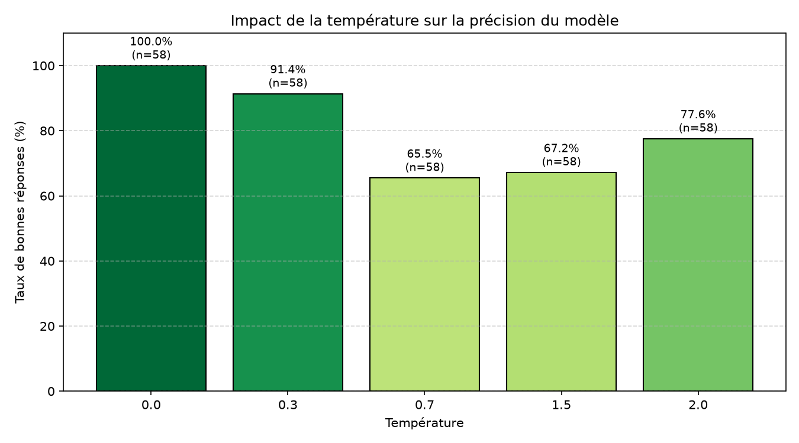

# Labo-Temperature

Expérience sur l'effet du paramètre `temperature` d'un LLM local (`llama3.2` via Ollama) sur l'extraction d'un montant de sinistre, dans un contexte d'assurance.

> **Périmètre réel** : seule la tâche A (factuelle) a été exécutée et analysée. La tâche B (slogan créatif) est définie dans `Taches.json` mais n'a pas été lancée.

## Arborescence

```text
Labo-Temperature/
├── data/
│   ├── Taches.json      # définition des tâches et de l'expérience
│   ├── sortie_a.jsonl   # réponses brutes (tâche A), une entrée par essai
│   ├── sortie.csv       # mêmes essais au format tabulaire
│   ├── stats.csv        # taux de réussite par température
│   └── graph.png        # graphique des résultats
├── src/
│   └── labo.py          # génération, scoring, stats, graphique
├── venv/
├── README.md
└── requirements.txt
```

## Hypothèse

- **Tâche factuelle (A)** : à température basse (0) le modèle extrait le bon montant de façon stable ; plus la température monte, plus les erreurs d'extraction augmentent (reprise d'un chiffre « piège », valeur inventée).
- **Tâche créative (B)** *(non testée)* : une température basse donne des slogans répétitifs, une température élevée des slogans plus variés, au risque de ne plus respecter la contrainte de 10 mots.

## Protocole

- **Modèle** : `llama3.2` en local via Ollama, sans `seed` fixé.
- **Tâche A** : extraire le montant total des dommages d'une déclaration de sinistre « dégât des eaux » (courrier fictif). Réponse attendue : `1850`. Le prompt demande uniquement un nombre, sans phrase.
- **Pièges numériques** dans le texte : n° de contrat `HAB-2026-48213`, dates `12/10/2026` et `15/10/2026`, surface `18` m², année `2019`, franchise `150` €, nombre de photos `6`.
- **Températures testées** : `0`, `0.3`, `0.7`, `1.5`, `2` (le `Taches.json` en prévoit seulement 3 et 10 essais ; le code a été étendu à 5 températures).
- **Essais** : 58 tours, chacun interrogeant le modèle une fois par température, soit **58 essais par température** et 290 appels au total.
- **Extraction de la réponse** (`extraire_montant`) : premier nombre trouvé dans la réponse du modèle (espaces et espaces insécables retirés), converti en entier.
- **Scoring** : une réponse est correcte si ce nombre est égal à `1850`. Le taux de réussite est calculé par température (`calculer_taux_reussite`).
- **Sorties** : chaque essai est stocké dans `sortie_a.jsonl` et `sortie.csv`, les agrégats dans `stats.csv`, le graphique dans `graph.png`.

## Résultats

| Température | Essais | Bonnes réponses | Taux de réussite |
|-------------|--------|-----------------|------------------|
| 0           | 58     | 58              | 100,0 %          |
| 0.3         | 58     | 53              | 91,4 %           |
| 0.7         | 58     | 38              | 65,5 %           |
| 1.5         | 58     | 39              | 67,2 %           |
| 2           | 58     | 45              | 77,6 %           |



**Nature des erreurs** : toutes les mauvaises réponses valent `1800` (5 à 0.3, 20 à 0.7, 19 à 1.5, 13 à 2). Aucune n'est un piège numérique (franchise, surface, année, etc.) : le modèle ne se trompe pas de chiffre, il **arrondit** `1 850` en `1800`.

## Conclusion

- **L'hypothèse est validée pour la partie basse de l'échelle** : à T=0 le modèle est parfait (58/58) et la précision se dégrade dès T=0.3 (91,4 %) puis nettement à T=0.7 (65,5 %).
- **Elle n'est pas validée au-delà** : le taux ne continue pas de baisser, il remonte à 67,2 % (T=1.5) puis 77,6 % (T=2). Avec 58 essais par condition, l'écart entre 0.7, 1.5 et 2 est de l'ordre du bruit d'échantillonnage (l'incertitude est d'environ ±6 points) : on ne peut pas conclure que T=2 est « meilleur » que T=0.7, seulement que ces trois conditions sont nettement moins fiables que T=0 et T=0.3.
- **Le type d'erreur est plus parlant que le taux** : l'erreur est un arrondi, pas une confusion avec un piège. C'est une erreur discrète, plausible, donc difficile à repérer à la relecture. Elle est plus dangereuse qu'une réponse manifestement absurde.

### Limites à garder en tête

- **Un seul texte, un seul modèle, un seul prompt** : le résultat ne se généralise pas à d'autres sinistres ni à d'autres modèles.
- **T=0 est quasi déterministe** : les 58 essais sont presque identiques, ce qui équivaut à très peu d'observations indépendantes. « 100 % » à T=0 signifie surtout « le modèle donne systématiquement la bonne réponse sur ce texte ».
- **Les réponses brutes du modèle ne sont pas conservées**, seul le nombre extrait l'est. On ne peut donc pas vérifier a posteriori si `1800` vient bien du modèle ou d'un défaut d'extraction.
- **Le prompt envoyé contient le texte source deux fois** (`prompt_a` contient déjà le texte, puis `labo.py` le rajoute), alors que `sortie.csv` ne stocke que `prompt_a`. Cela peut influencer les résultats.
- **Tâche B non exécutée** : tout ce qui concerne la créativité ci-dessous est un raisonnement, pas un résultat mesuré.

## Conclusion 

**Extraction d'un montant de sinistre : température 0.**
L'extraction est une tâche à une seule bonne réponse, avec un enjeu financier : une erreur de 50 € se répète sur des milliers de dossiers et se retrouve dans les provisions ou l'indemnisation. T=0 est la seule condition mesurée sans aucune erreur, et elle rend le traitement reproductible, donc auditable (même dossier, même résultat). Dès 0.3, environ 1 réponse sur 12 est fausse. En production il faut en plus un garde-fou indépendant (cohérence avec le devis, seuil d'alerte, relecture humaine par échantillonnage) : T=0 réduit le risque d'erreur, il ne le supprime pas.

**Campagne marketing : température moyenne à élevée (environ 0.7 à 1).**
Un slogan n'a pas de réponse unique : on cherche de la variété pour choisir parmi plusieurs propositions. À T=0 on obtiendrait toujours le même slogan, sans intérêt. Une température modérée donne de la diversité en gardant un texte cohérent. Au-delà (1.5 et plus), le risque est de produire des phrases bancales ou qui dépassent la contrainte de longueur. Ici, une erreur coûte peu : un humain relit et choisit, et un slogan raté s'écarte simplement. Ce choix reste à confirmer en exécutant la tâche B (nombre de mots, nombre de slogans distincts sur 10).

**Pourquoi cette différence** : la température règle le compromis entre fiabilité et diversité. Quand l'erreur est coûteuse et qu'une seule réponse est correcte, on veut du déterministe ; quand on cherche des idées et que l'humain valide, la variabilité devient un atout.
